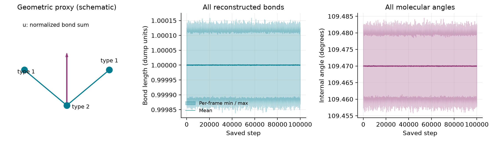
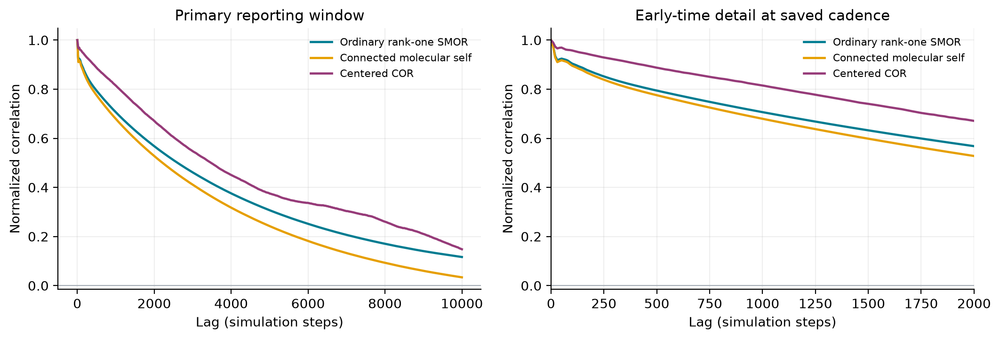
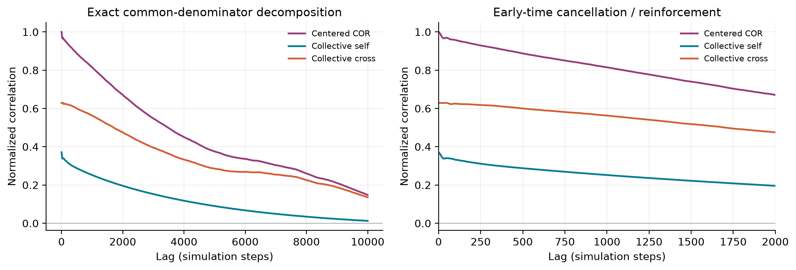
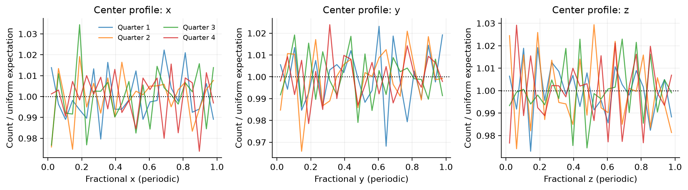

# Collective versus single-molecule orientational relaxation

CB4103 | Concise dataset and results report

## Dataset and molecular geometry

Collective versus single-molecule orientational relaxation | CB4103

The trajectory contains nearly rigid, water-like molecular groups. Individual and collective orientation correlations are compared using a normalized molecular-bisector proxy. All saved frames are retained.

| Dataset property | Verified information |
| --- | --- |
| Source | dumpr.lammpstrj (7,817,235,449 bytes) |
| Composition | 8,232 atoms; 2,744 molecular groups |
| Molecular grouping | One type-2 center and two type-1 satellites per group |
| Saved record | 10,001 complete frames; steps 0–100,000 |
| Saving interval | Every 10 simulation steps |
| Simulation box | Periodic cube; side length 43.51827618 dump units |
| Coordinates and audit | Wrapped Cartesian coordinates; all frames, membership and intervals checked |
| Unavailable metadata | Force field, units, timestep, charges, temperature, ensemble and dump-group completeness |

Figure 1. Molecular-bisector schematic and bond-length/angle histories. Shaded envelopes show the minimum and maximum over every molecule in each frame; solid lines show the means. Atom-type chemistry is inferred.

| Geometry measure | Mean | Observed range |
| --- | --- | --- |
| Bond length / dump units | 1.00000018 | 0.99983905–1.00015874 |
| Internal angle / degrees | 109.469979° | 109.455850°–109.484493° |

Minimum-image reconstruction corrects intramolecular boundary crossings for 6.10% of groups per frame on average. The stable geometry supports an orientation proxy; it does not determine a charge model.

## Orientation definitions and main correlations

Bond vectors use the shortest periodic displacement, applied component by component. O and H label the inferred central and satellite sites; a labels either satellite.

$$
\mathbf{b}_{ia}=\mathbf{r}_{\mathrm{H}_a}-\mathbf{r}_{\mathrm{O}}-\mathbf{L}\,\operatorname{round}\!\left(\dfrac{\mathbf{r}_{\mathrm{H}_a}-\mathbf{r}_{\mathrm{O}}}{\mathbf{L}}\right)
$$

$$
\mathbf{u}_i=\dfrac{\mathbf{b}_{i1}+\mathbf{b}_{i2}}{|\mathbf{b}_{i1}+\mathbf{b}_{i2}|},\qquad \mathbf{U}=\sum_{i=1}^{N}\mathbf{u}_i
$$

$$
\mathbf{v}_i=\mathbf{u}_i-\overline{\mathbf{u}_i},\qquad \delta\mathbf{U}=\mathbf{U}-\overline{\mathbf{U}}=\sum_i\mathbf{v}_i
$$

$$
C_{\mathrm{SMOR}}(k)=\dfrac{1}{N}\sum_{i=1}^{N}\langle\mathbf{u}_i(n)\cdot\mathbf{u}_i(n+k)\rangle
$$

$$
A(k)=\sum_i\langle\mathbf{v}_i(n)\cdot\mathbf{v}_i(n+k)\rangle,\qquad C_{\mathrm{conn}}(k)=\dfrac{A(k)}{A(0)}
$$

$$
B(k)=\langle\delta\mathbf{U}(n)\cdot\delta\mathbf{U}(n+k)\rangle,\qquad C_{\mathrm{COR}}(k)=\dfrac{B(k)}{B(0)}
$$

Here N is the molecule count, n indexes saved frames and k is a frame lag. Each lag interval corresponds to 10 simulation steps. Brackets average all valid starting frames. Overbars use the same full record. Ordinary SMOR retains molecular means; connected self and COR measure fluctuations about their means.

Figure 2. Ordinary SMOR, connected molecular self and centered COR. The right panel expands the early decay; all delays are in simulation steps.

| Lag / steps | SMOR | Connected self | COR |
| --- | --- | --- | --- |
| 2,500 | 0.51124 | 0.46583 | 0.60495 |
| 10,000 | 0.11641 | 0.03367 | 0.14801 |

The full-record collective correlation exceeds ordinary SMOR at both listed lags. Both retain positive correlation at 10,000 steps.

## Collective contributions and spatial profiles

The collective signal separates exactly into same-molecule self terms and different-molecule cross terms. Both contributions use the total zero-lag variance.

$$
C_{\mathrm{self}}(k)=\dfrac{A(k)}{B(0)},\qquad C_{\mathrm{cross}}(k)=\dfrac{B(k)-A(k)}{B(0)}
$$

$$
C_{\mathrm{COR}}(k)=C_{\mathrm{self}}(k)+C_{\mathrm{cross}}(k),\qquad G_{\mathrm{cell}}=\dfrac{B(0)}{A(0)}=2.6958
$$

Figure 3. Exact collective self/cross decomposition. At every lag, the two contributions sum to COR. Cross contributions may be negative.

| Lag / steps | Collective self | Collective cross | Sum / COR |
| --- | --- | --- | --- |
| 0 | 0.37095 | 0.62905 | 1.00000 |
| 2,500 | 0.17280 | 0.43215 | 0.60495 |

Cross terms contribute 62.91% of the normalized zero-lag collective signal. The finite-cell factor describes fluctuation amplitudes; it does not by itself determine relaxation-time ordering.

Figure 4. Molecular-center counts in 24 fractional-coordinate bins per axis, shown separately for each trajectory quarter. A value of one indicates uniform-bin counts.

Maximum full-record deviations from uniform counts are x: 1.14%, y: 1.39%, z: 1.38%. These projected counts do not establish a bulk phase or thermal equilibration.

## Running integrals and result limits

Running integrals measure accumulated orientation correlation through a declared upper cutoff. Numerical integration uses the trapezoidal rule.

$$
I_C(T)=\int_0^T C(\tau)\,\mathrm{d}\tau
$$

Figure 5. Finite-cutoff running integrals and their collective self/cross contributions. The curves continue to increase near the final cutoff; full relaxation times remain unresolved.

| Cutoff / steps | SMOR integral | Connected integral | COR integral |
| --- | --- | --- | --- |
| 1,000 | 804.32 | 786.40 | 890.91 |
| 2,500 | 1,707.75 | 1,634.56 | 1,950.59 |
| 5,000 | 2,707.69 | 2,494.84 | 3,147.57 |
| 10,000 | 3,684.98 | 3,096.30 | 4,520.64 |

All integral values are in simulation steps. During the final 2,000 steps of the reporting window, the SMOR and COR integrals increase by 282.9 and 413.9 steps, respectively. The reported areas therefore remain dependent on the cutoff.

### Sampling and numerical checks

Quarter-record estimates of the finite-cell factor range from 1.7618 to 2.6971, showing segment sensitivity. These blocks do not provide independent-run confidence intervals. Direct correlation and explicit pair-sum checks agree with the fast estimator within floating-point precision; the maximum full-record decomposition error is 1.11 × 10⁻¹⁶.

### Interpretation

The supplied record shows substantial intermolecular contributions and a larger collective correlation at the reported lags. Missing timestep and charge information restrict the results to simulation-step units and a geometric orientation proxy. Finite-record mean subtraction and segment variation limit the long-time interpretation; converged full relaxation times and dielectric response are not established.

### Method reference and result files

Maurya, Metya, Singh and Saito (2021), Journal of Chemical Physics 154, 164704. DOI: 10.1063/5.0046817. Orientation-correlation definitions are adapted to the supplied dataset.

Dataset audit: results/metadata.json. Measured curves: results/correlations.csv. Integrals and sensitivity results: results/summary.json. Numerical checks: results/numerical_checks.json.
