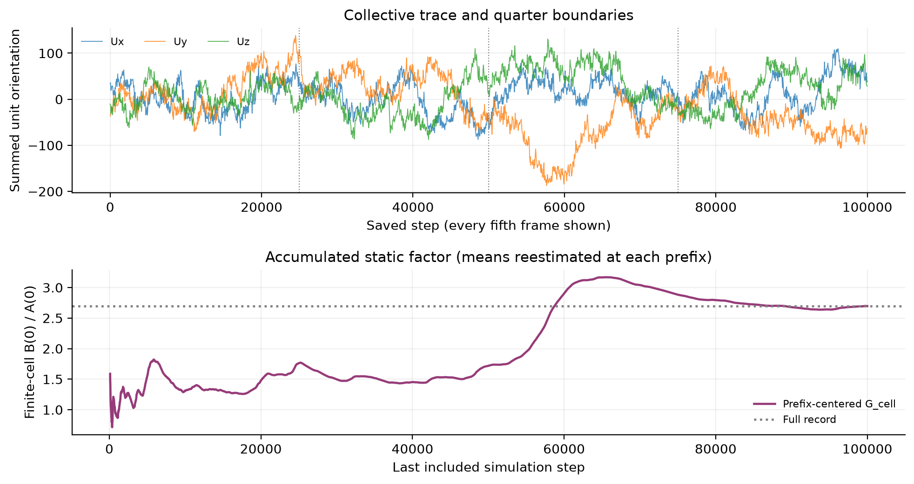
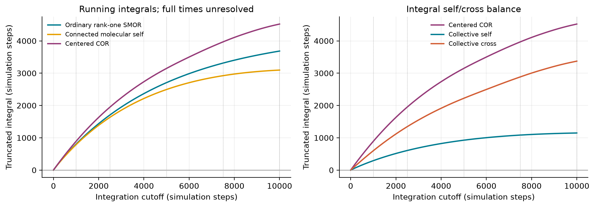
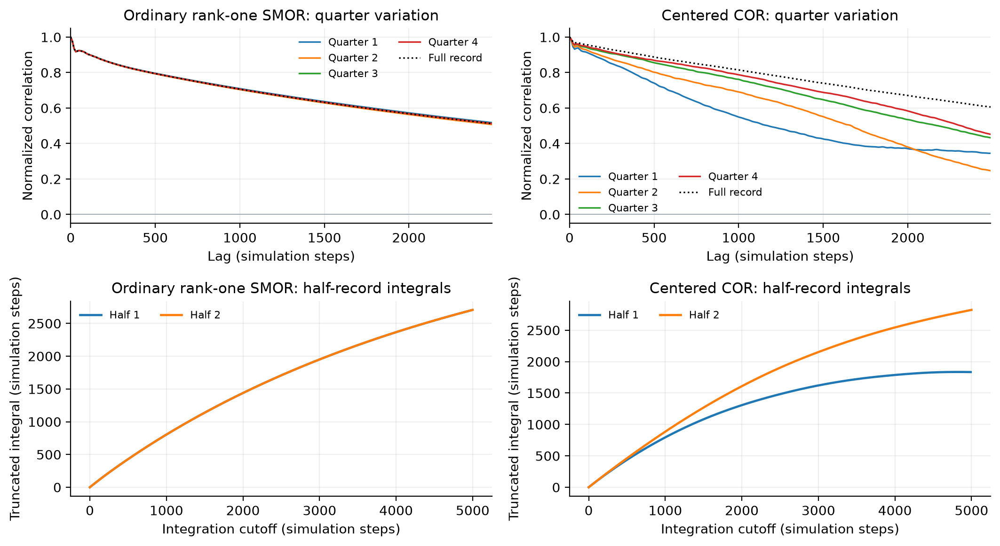
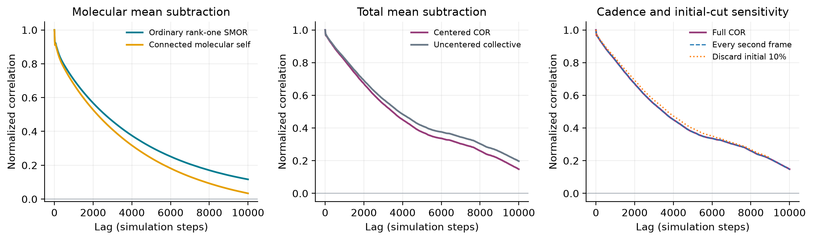

# Collective versus single-molecule orientational relaxation

CB4103 course project | Analysis of the supplied trajectory | 15 November 2026

## Abstract

We compare individual molecular orientation memory with fluctuations of the summed molecular orientation. Molecule-resolved periodic reconstruction, a complete frame audit, and independent correlation checks precede interpretation. The complete record contains 10,001 frames and 2,744 water-like molecular groups over 0-100,000 simulation steps. The centered finite-cell factor is G_cell = 2.6958; quarter estimates range from 1.7618 to 2.6971. At lag 2,500 steps, ordinary SMOR is 0.5112 and centered COR is 0.6049. Integrals through 10,000 steps are 3684.98 steps for SMOR and 4520.64 steps for COR; these are finite-cutoff measures, not converged full relaxation times.

## Scientific question and literature

Collective relaxation can differ from individual rotation because distinct molecules contribute cross correlations. Expanding the correlation of a sum gives an exact self/cross identity. A static correlation factor controls initial amplitudes but does not alone determine relaxation-time ordering.

Maurya et al. (2021), Section III.C, Eqs. (2)-(11), Figs. 10-12 and Table IV, is the methodological anchor. Their TIP4P/2005 simulations use graphene droplets and a bulk reference, with known 300 K conditions and physical time. The supplied dataset has unknown provenance. We adapt the definitions rather than reproduce their numerical results.

| Published system ONLY | SMOR / ps | COR / ps | Reported G_K |
| --- | --- | --- | --- |
| Bulk reference | 5.37 | 11.86 | 3.23 |
| Graphene droplet, usual interaction | 5.43 | 0.90 | 0.24 |
| Droplet, strongest listed interaction | 6.34 | 2.25 | 0.40 |

Published benchmark values above are transcribed from Table IV; none are measurements from dumpr.lammpstrj. The paper retains a dynamic correction in its time-scale relation, so tau_COR = G_cell * tau_SMOR is not imposed here.

Deliverables include reusable source/configuration, full-data caches and diagnostics, numerical validation, figures, this report, and an editable presentation.

# 1. Dataset, provenance and reconstructed geometry

| Property | Verified value or limitation |
| --- | --- |
| Raw source | dumpr.lammpstrj; 7,817,235,449 bytes; original preserved |
| Integrity scope | All 10,001 complete frames; clean end of file |
| Composition | 8,232 atoms; 2,744 stable groups; each type pattern (1,1,2) |
| Step sequence | 0 to 100000; every interval 10 steps |
| Coordinates / box | Wrapped x,y,z; fully periodic orthorhombic; box read every frame |
| Side lengths | 43.51827618, 43.51827618, 43.51827618 dump units |
| Unavailable | Model, units, timestep, charges, temperature, ensemble, full dump group |
| Retained record | All frames; initial-10%-removed result supplied as sensitivity only |


Every reconstructed molecule in every frame contributes to the geometry envelopes. The diagram defines the proxy and is schematic. Type labels are inferred chemistry, not verified force-field provenance.

Across all frames and molecules, reconstructed bond lengths span 0.99983905-1.00015874 dump units; mean 1.00000018. Angles span 109.455850-109.484493 degrees; mean 109.469979. On average 6.10% of molecular groups require an intramolecular periodic correction.

The unnormalized bond-sum magnitude spans 1.15443530-1.15500388 dump units. Near-constant geometry supports a constant-magnitude geometric proxy, conditional on equal symmetric charge sites. It does not identify the charge model. SPC and SPC/E share this geometry but differ in charge assignments; virtual sites and polarization would require model-specific treatment.

Atom IDs, molecule IDs and types are validated in stable ID order in every frame. Frame hashes and explicit molecule ordering allow independent provenance checks. The trajectory may omit a substrate or other groups; water-like composition does not prove a homogeneous full-system simulation.

# 2. Estimators, centering and independent validation

```text
b_ia = r_Ha - r_O - L round((r_Ha-r_O)/L)
u_i = (b_i1 + b_i2) / |b_i1 + b_i2|; U = sum_i u_i
v_i = u_i - mean_t(u_i); delta U = U - mean_t(U)
R(k) = sum_i <u_i(t) dot u_i(t+k)>; SMOR = R(k)/N
A(k) = sum_i <v_i(t) dot v_i(t+k)>; connected self = A(k)/A(0)
B(k) = <delta U(t) dot delta U(t+k)>; COR = B(k)/B(0)
collective self = A(k)/B(0)
collective cross = [B(k)-A(k)]/B(0)
G_cell = B(0)/A(0); self(0) = 1/G_cell
running integral(T) = trapezoidal integral from 0 to T of C(t) dt
```

Angle brackets average all F-k valid origins at lag k. Each molecular mean and the total mean are estimated once over the same retained segment. This ensures delta U = sum_i v_i. Ordinary SMOR is computed separately; it retains persistent or finite-record molecular means. Both collective contributions share B(0), and cross values may be negative.

The FFT estimator zero-pads to at least 2F-1, sums autocorrelation channel powers in float64, inverse transforms, and divides by F-k. Molecules are processed in batches of 64 from a float32 memory map. No all-pairs loop is needed for production cross terms. Direct time-domain and explicit ordered-pair sums are independent small-system checks.

| Check | Actual result |
| --- | --- |
| Scientific pytest suite | 24 passed in 0.78s |
| Actual-data FFT vs direct | Max error 3.331e-16; 128 frames x 24 molecules |
| Actual-data ordered-pair cross | Max error 4.441e-16; 32 frames x 8 molecules |
| Full-record decomposition | Max error 1.110e-16 |
| Cached unit-vector norms | Max absolute error 5.088e-08 |
| Frame/cadence audit | 10,001 frames; all 10,000 intervals validated |

Analytic tests include a rotating unit vector, a persistent orientation component, an exponential with known integral/scale, negative cross terms, and noncircular endpoint normalization. Reader tests include split molecules, unsorted and nonconsecutive IDs, multiple molecule orders, reordered columns, nonfinite data, malformed rows, changing membership, wrong cadence and truncation.

Centering creates a finite-record constraint: F A(0) + 2 sum_(k>0) (F-k) A(k) = 0 when all lags are included. Long negative tails can therefore arise from mean estimation. Segment sensitivity is essential; an integral to the final saved lag is not a valid convergence certificate.

# 3. Spatial and collective sampling diagnostics


Center number profiles use fractional periodic positions and 24 bins per axis. Quarter-to-quarter curves show variation; projection uniformity does not prove bulk phase or full-system provenance.


Collective components are sampled only for display. The finite-cell factor uses all available frames up to each endpoint with means reestimated; early-prefix changes and block differences diagnose finite sampling, not thermal equilibration.

Fractional-coordinate profiles use the inferred central sites and wrap only for binning. The maximum full-record deviation from the uniform-bin expectation is x: 1.14%, y: 1.39%, z: 1.38%. These are projected number profiles, not mass density or a structural phase identification.

Collective traces and the prefix-centered factor show how much the estimate depends on the available record. Each prefix reestimates its means; early values use little information. The quarter means of U_y are 18.88, 27.67, -71.65, -35.10. Full-record component variances (x,y,z) are 1257.96, 3669.78, 1861.09. This variation flags sampling of slow collective modes; it does not distinguish equilibration, persistent order or finite-record fluctuations. No thermal or energetic equilibration claim is possible without logs.

# 4. Observed orientation correlations and cross terms


Ordinary rank-one SMOR, connected molecular self and centered collective COR use all F-k origins. Full-record reporting lag is at most one tenth of duration. Simulation-step axes cannot be converted to ps without the integration timestep.


Both self and cross use the same B(0) denominator. Their sum reconstructs centered COR at every lag. Negative cross contributions are retained. The zero-lag self amplitude is 1/G_cell, not one.

At zero lag, A(0) = 2518.29556 and B(0) = 6788.82660. Thus G_cell = 2.69580, collective self(0) = 0.37095, and collective cross(0) = 0.62905. For comparison, B(0)/N = 2.47406, while the uncentered raw factor is 2.67908. These distinct conventions must not be interchanged.

At lag 2,500 steps, ordinary SMOR = 0.51124, connected self = 0.46583, and COR = 0.60495. The collective self and cross contributions there are 0.17280 and 0.43215. At 10,000 steps, ordinary SMOR = 0.11641 and COR = 0.14801.

These comparisons describe this full-record estimator at declared lags. Intermolecular terms alter the collective signal, but the curves do not identify a unique microscopic hydrogen-bond mechanism. A static factor alone cannot establish a full-time relaxation ordering.

# 5. Running integrals, fit scales and convergence limits


Trapezoidal integrals depend on the declared upper cutoff. Vertical guides mark saved cutoff estimates. Curves are not certified converged full relaxation times; no tail is extrapolated.

| Cutoff / steps | Ordinary SMOR | Connected self | Centered COR |
| --- | --- | --- | --- |
| 1000 | 804.324 | 786.402 | 890.911 |
| 2500 | 1707.751 | 1634.564 | 1950.589 |
| 5000 | 2707.691 | 2494.843 | 3147.574 |
| 7500 | 3312.688 | 2922.978 | 3969.235 |
| 10000 | 3684.983 | 3096.300 | 4520.638 |

All table entries are truncated integrals in simulation steps. The cutoff dependence is part of the result. They are not full relaxation times, and their ratio is not reported as a converged time-scale ratio.

| Fit curve | tau_fit / steps | RMSE | Adequacy |
| --- | --- | --- | --- |
| smor | 4349 | 0.006176 | supported window |
| connected_self | 3794 | 0.005772 | supported window |
| cor | 5311 | 0.003171 | rejected / unresolved |

The secondary fit uses a * exp(-lag/tau_fit) over the fixed 100-2,500 step window. Adequacy requires positive data across the window, at least 0.05 decay span, RMSE below 0.03, R-squared above 0.95, and tau no larger than twice the window width. A supported window fit is descriptive; correlated residuals are not treated as IID errors and no confidence interval or full-time tail is inferred.

In the final 20% of the reporting window, the SMOR running integral changes by 282.9 steps, and the COR integral changes by 413.9 steps. The first zero crossings are None and None steps respectively (None means absent in this window).

The full integral times remain unresolved. Longer records with independent replicas, stable centering and stable late cutoffs are needed before a physical ordering or uncertainty interval can be claimed.

# 6. Segment, centering and sampling sensitivity


Nonoverlapping quarters use locally estimated means, with lags <= one tenth of each quarter duration; halves similarly restrict lags. These curves show block variation, not confidence bounds or independent molecular replicates.


Centering is a finite-record convention and can alter long-lag behavior. Downsampling tests sensitivity to saved cadence but cannot recover dynamics faster than ten steps. The initial 10% removal is a sensitivity calculation, not an asserted equilibration cutoff.

Quarter G_cell values range from 1.76182 to 2.69707. Quarters contain roughly 2,500 frames each, so their lags stop near 2,500 steps. Halves stop near 5,000 steps. These records do not create four fully independent realizations; block variation is shown without confidence bands.

The maximum ordinary-minus-connected self difference is 0.08274; centered-versus-uncentered collective difference is 0.04920. The squared total mean divided by centered total variance is 0.08287. Molecular mean-square orientation per molecule is 0.08225.

Every-second-frame analysis changes SMOR by at most 1.190e-05 and COR by at most 2.669e-04 at common lags. This tests cadence sensitivity but cannot recover unsaved motion faster than 10 steps. Removing the first 10% is a sensitivity analysis, not proof of an equilibration boundary.

# 7. Interpretation, limitations and six-person delivery

The complete record contains 10,001 frames and 2,744 water-like molecular groups over 0-100,000 simulation steps. The centered finite-cell factor is G_cell = 2.6958; quarter estimates range from 1.7618 to 2.6971. At lag 2,500 steps, ordinary SMOR is 0.5112 and centered COR is 0.6049. Integrals through 10,000 steps are 3684.98 steps for SMOR and 4520.64 steps for COR; these are finite-cutoff measures, not converged full relaxation times.

The defensible contribution is a fully audited orientation-proxy analysis and exact dynamic self/cross decomposition, accompanied by finite-record sensitivity diagnostics. The supplied data support numerical statements at specified lags and cutoffs. They do not by themselves establish a force field, physical dielectric response, temperature trend, or converged full relaxation ordering.

## Material limitations

1. Force field, unit style, integration timestep, charges, temperature, ensemble and dump-group completeness are unavailable.

2. Normalized bisectors are identical-dipole geometric proxies; nearly rigid geometry does not prove physical charge-site provenance.

3. All lags, fitted scales and truncated integrals are in simulation steps; no ps conversion or dielectric constant is justified.

4. Full relaxation integrals are not certified converged. Fits describe specified windows and correlated residuals have no IID confidence interval.

5. Four temporal blocks give variation, not a calibrated confidence interval. Collective signal has one summed vector per frame.

6. Molecular and collective finite-sample mean subtraction can bias long-lag correlations; alternative centering and segments are shown.

7. Spatial profiles and orientation traces cannot establish temperature/energy equilibration without simulation logs.

8. Finite-cell factor B(0)/A(0) uses molecular time-mean centering and is not automatically a macroscopic Kirkwood factor.

9. Trajectory may be a selected atom group; no bulk-water, droplet, substrate or hydrate identity is established.

## Presentation ownership (organizational roles)

| Person | Ownership | Speaking responsibility |
| --- | --- | --- |
| 1 | Question, literature, provenance | Opening, published benchmarks, unknown metadata |
| 2 | Reader and molecular reconstruction | Full integrity, MIC geometry, cache provenance |
| 3 | SMOR and connected self | Orientation choice, centering, running integrals |
| 4 | COR and intermolecular terms | Common denominator, factor, negative cross |
| 5 | Validation and sampling | FFT/direct, pair sums, blocks, convergence limits |
| 6 | Figures and reproducibility | Artifact navigation, commands, closing interpretation |

Every student should explain the same central identity and the largest limitation. One implementation was completed for the project; these six roles allocate review and presentation responsibility, not separate claims of software authorship.

# References, viva preparation and reproducibility

[1] Maurya, Metya, Singh and Saito (2021), J. Chem. Phys. 154, 164704. https://doi.org/10.1063/5.0046817 Supplied full PDF: primary methods and Table IV.

[2] LAMMPS dump documentation. https://docs.lammps.org/dump.html (accessed 15 November 2026). Coordinate semantics, grouping and box formats.

[3] LAMMPS SPC/SPC/E documentation. https://docs.lammps.org/Howto_spc.html (accessed 15 November 2026). Shared geometry does not identify charges.

[4] Liu et al. (2022), HTR. https://doi.org/10.1515/ntrev-2022-0044; Shi et al. (2024), HTR+. https://doi.org/10.1088/1361-648X/ad52df. Supplied structural-classification papers; optional future context.

[5] Rodger, Forester and Smith (1996), Fluid Phase Equilibria 116, 326-332. Supplied hydrate-interface context, not a COR benchmark.

[6] Du et al. (2019). https://doi.org/10.1016/j.ijheatmasstransfer.2018.11.044; Krachkovskiy et al. (2020). https://doi.org/10.1021/acs.jpcc.0c07383. General structure/transport context only.

[7] Varnik, Baschnagel and Binder (2000). https://doi.org/10.1063/1.1288390. Supplied pressure-tensor background; filename year 2020 is incorrect.

## Likely viva questions

Why can COR differ from SMOR? The correlation of a sum includes distinct-molecule cross terms.

Why is each contribution not normalized to one? Both use B(0), so self(0)=1/G_cell and cross(0)=1-1/G_cell.

Can a cross term be negative? Yes. Anticorrelated orientations can cancel self contributions.

Why no picoseconds or model name? The integration timestep, units and charge model are unavailable; geometry is not provenance.

Why subtract molecular means? It gives an exact connected decomposition, but finite-record means can bias the long tail; ordinary SMOR is also shown.

Why zero-pad and divide by F-k? To avoid circular wraparound and account for fewer origins at larger lag.

Does G_cell determine time ordering? No. Dynamic cross terms and convergence are also needed.

Why is full tau unresolved? Finite cutoffs, mean estimation and segment variation do not establish a stable full-time integral or tail.

Are 2,744 molecules independent COR samples? No. COR has one summed vector per saved frame and temporally overlapping origins.

## Reproduce and inspect

```text
.venv/Scripts/python.exe -m pytest -q
.venv/Scripts/python.exe -m corsmor.cli all --config config/analysis.json
```

See README.md for clean environment setup and exact stage commands. results/metadata.json records source identity, complete audit and geometry; summary.json records estimators and limitations; validation.json separates numerical success from physical unknowns. All figures have PNG/SVG/PDF versions. submission/manifest.json lists artifacts without copying the raw trajectory.
